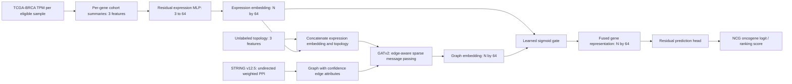

# Phase 4 architecture design: HMGAT-ET

**Historical Phase 4 status:** This document was originally a design-only specification before the mapping and training follow-up. The crosswalk, model implementation, and evaluation are now complete; see the final implementation results section below and `phase6_model_evaluation.md`.

## Research question and output meaning

The primary task is gene-level prediction of the **pan-cancer NCG `NCG_oncogene` annotation** in the NCG cohort, with TCGA-BRCA-derived gene summaries as one input modality. The architecture will estimate a source-label score. It will not output a confirmed biological driver probability, BRCA-specific causal claim, or independent discovery result. An unknown NCG gene may be ranked only as a model-scored candidate, with its unknown status retained.

The proposed project architecture name is **Hybrid Multi-Modal Graph Attention and Expression Transformer Network (HMGAT-ET)**. This is a project name, not a claim that an established or novel literature model has been verified. The design retains gated fusion and graph attention. A Transformer block is deferred because the planned input is a three-statistic vector per gene, not an ordered expression sequence; graph neighborhoods already express relational structure. Cross-attention is also deferred because both modalities produce one vector per gene and have no meaningful token sequence to query. The “T” in the proposed name therefore remains descriptive/aspirational; implementation should not add a Transformer without a defensible tokenization and a controlled benefit.

## Inputs and alignment

After expression/label identifier mapping is resolved:

- `N`: genes in the frozen eligible NCG cohort after stable-ID mapping.
- Expression tensor `X_e ∈ R^(N×3)`: per-gene mean and standard deviation of `log2(TPM+1)` and fraction of eligible primary BRCA samples with TPM > 0.
- Topology tensor `X_p ∈ R^(N×3)`: `log1p(degree)`, confidence-weighted degree (using STRING score / 1000), and unweighted local clustering coefficient. These use graph structure only and no cancer labels.
- PPI graph `G=(V,E)`: undirected, gene-level STRING association graph, fixed confidence threshold (initially 700, chosen without test labels), edge score normalized to `[0,1]` as the edge attribute.
- Label tensor: training mask and target for positive/explicit-zero NCG oncogene genes only. Unknown genes are unlabeled; conflicts are masked/excluded. Labels are never included in node features, edge weights, sampling, or preprocessing.

The validated graph has 3,325 NCG genes with an unambiguous v12.5 protein mapping, including 2,799 nodes with at least one score-700 edge. The separate expression feature table has 60,660 versioned Ensembl IDs and was summarized over 1,092 primary-tumor cases. The NCG target has 256 positive, 335 explicit-zero, and 2,756 unknown genes. Exact-symbol candidates suggest an overlap, but these are **not final hybrid model dimensions**: the Ensembl v102 mapping query did not return tabular data. Do not join the expression table to labels by symbol without a reviewed, explicit mapping decision.

The graph will include every eligible gene with an unambiguous protein mapping, even when no edge passes the fixed score threshold. Such a node receives only a self-message in GAT. Genes without a mapped protein cannot enter the hybrid comparison; report them separately and retain them for an expression-only comparison where expression mapping exists. Do not silently drop isolated or unmapped genes.

## Proposed data flow

## Encoder and fusion details

### Expression encoder

Input is three cohort-level statistics per gene, not a sample-by-gene matrix and not a sequence of patients. Apply a small MLP independently to each gene: `3 → 32 → 64`, with LayerNorm, GELU/ReLU, dropout (start at 0.2), and a residual connection in the 64-dimensional block. It emits `h_e ∈ R^(N×64)`. Numeric imputation/scaling is fitted inside each training fold. Do not use outcome labels to select the cohort or compute expression summaries.

### PPI graph attention encoder

Concatenate `h_e` (64) and the three topology values (3), giving `N×67`. Two sparse GATv2 layers use four attention heads of 16 channels each, concatenated to 64 channels, with normalization, GELU, and dropout between layers. The second layer emits `h_g ∈ R^(N×64)`. `edge_index` contains both directions for every undirected edge. Add exactly one self-loop per node so isolated mapped genes can preserve their node representation. Pass STRING confidence as a normalized edge attribute to attention; learned attention weights describe model aggregation and are not interpreted as measured interaction strengths.

The default GAT is transductive: unlabeled graph structure and node inputs for train/test genes may be visible, while test labels remain masked. Report this protocol clearly. No target-derived topology or label propagation is allowed.

### Cross-modal gated fusion

Compute `g = sigmoid(W_g [h_e || h_g] + b_g)` with a 128-to-64 learned projection and `h_f = g ⊙ h_e + (1-g) ⊙ h_g`. This yields a per-gene gate, not a globally fixed modality weight. Log gate summaries for interpretation, but do not claim gate values are causal explanations. Compare against simple concatenation with a matched-capacity prediction head.

### Residual prediction head

Use a 64-dimensional residual MLP block with LayerNorm, GELU, dropout (start at 0.3), followed by a one-unit output logit. Train with `BCEWithLogitsLoss`; estimate class weighting from the training fold only. Tune early stopping and learning rate on development folds. Save logits and ranking scores. Call outputs probabilities only if calibration is separately evaluated on held-out data.

## Supporting models and ablations

Use the same eligible genes, labels, folds, and evaluation protocol for all comparisons:

1. Dummy and regularized Logistic Regression on expression features.
2. Small MLP on expression features only.
3. Logistic Regression/MLP on three topology features only.
4. GAT on expression plus topology node inputs, without expression/graph fusion.
5. Expression encoder + GAT + simple concatenation.
6. Full expression encoder + GAT + gated fusion (primary HMGAT-ET).
7. GCN or GraphSAGE as a controlled replacement for the GAT to test the attention choice.
8. Optional second GraphSAGE branch only if a single-encoder comparison shows complementary signal and nested development folds support it. Do not include multi-scale learning by default.

The breast-evidence-restricted cohort (52 positive, 99 explicit zero, 147 unknown) is a sensitivity analysis, not another independent test set. It is too small to justify a high-capacity model on its own. COSMIC overlap and the prior NCG logistic-regression holdout are not independent final validation for this experiment.

## Training and evaluation controls

- Freeze the model gene universe after stable-ID mapping, cohort selection, and graph construction.
- Set aside one stratified gene-level 20% final test partition after eligibility is fixed. Do not inspect its metrics until architecture and thresholds are locked.
- Use nested/repeated stratified cross-validation on the development genes for model selection, class weights, early stopping, and threshold decisions. Fit all trainable data transformations only in each training fold.
- Report average precision/PR-AUC, ROC-AUC, MCC, balanced accuracy, precision, recall, F1, specificity, and variability. Include class prevalence and the fold-specific support.
- Evaluate a connected-component holdout sensitivity if class support allows. The provisional graph's 27 components include a giant component of 2,743 nodes; document any inability to form class-balanced component splits.
- Include uncertainty and limitations; do not tune the network threshold, model, or cutoff using final test labels.
- Do not use SMOTE or duplicate genes to inflate the sample count.

## Feasibility and implementation gates

The graph is modest (about 3,300 candidate nodes and 25,000 high-confidence edges in the current provisional induced network), so sparse GAT computation should fit a small CPU run. However, only 589 genes currently have observed labels, the machine had approximately 0.83 GiB available RAM at audit time, and PyTorch is absent from the current environment. No dependency is installed here. Before implementation/training, resolve cohort and identifier blockers, check current memory/disk again, decide whether the dependency install is authorized, and run a tiny forward/backward smoke configuration before any full experiment.

The primary hybrid model is justified only if controlled ablations show reproducible improvement over expression-only and topology/GNN-only baselines on development folds and it does not fail the final holdout. If the gated model is unstable or not better, report that evidence and use a smaller model. No performance claim or training result exists yet.

## Required artifacts for later phases

After the input gates clear, implement a configuration-driven pipeline that records input checksums, cohort rules, feature definitions, mapping tables, graph threshold/version, split IDs, random seed, model dimensions, training logs, and runtime. Produce model-ready features, graph edge/index data, separate labels/masks, split manifest, saved predictions, metrics JSON/CSV, ablation outputs, and figures only from actual runs. Preserve existing baseline and validation artifacts.

## Implementation and observed results

The mapping and training blockers in the design status above are superseded. The exact-ID NCBI crosswalk yielded 3,304 eligible genes, with 587 supervised labels (254 positive, 333 explicit zero) and 2,717 unknown labels kept masked. Inputs were built without COSMIC or target-derived predictors. Nine neural configurations and a logistic reference were trained/evaluated with a stratified 80/20 gene holdout and 3-fold development CV. CV-selected GCN had CV AP 0.5693 ± 0.0517 and held-out AP 0.6030. HMGAT-ET gated fusion did not outperform the graph-only baselines (CV AP 0.5039 ± 0.0173; held-out AP 0.4105). The component-held-out evaluation was infeasible under minimum class support (outside largest component: 7 positives, 8 explicit zeros). See `reports/phase6_model_evaluation.md` for the complete comparison and limitations. This confirms feasibility of the implementation, not readiness for a validated biological discovery claim.

